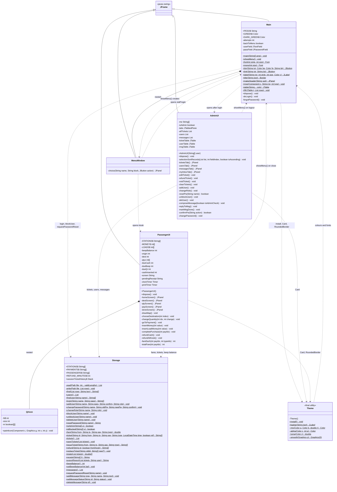
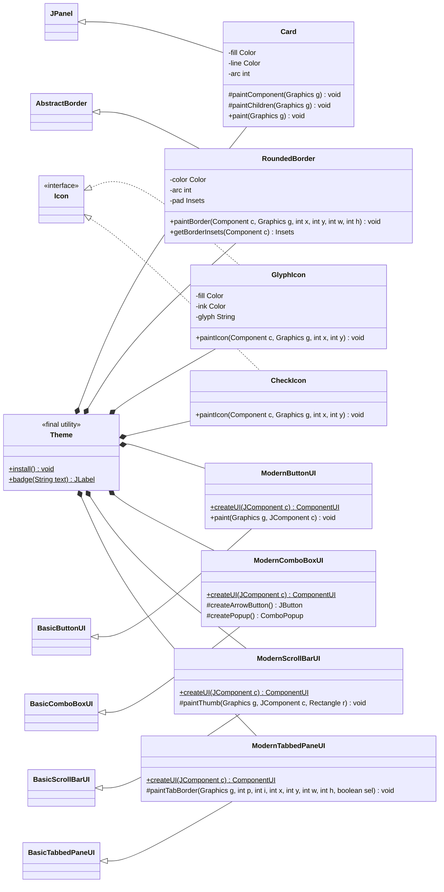

# LRT-1 Ticketing System

A Java Swing desktop app that simulates an LRT-1 ticket kiosk (passengers) and a back office (staff / admin).

- **Passenger kiosk** – buy single-journey / QR tickets, pay with cash, Beep Card or GCash/Maya, load a Beep Card, request refunds
- **Staff / Admin back office** – manage tickets, users, messages, and export sales reports
- **Storage** – plain-text files (`users.txt`, `tickets.txt`, `beep_balance.txt`, `messages.txt`)
- **DSA used** – Stack (session ticket history), Linear Search (`Storage.find`), Selection Sort (`AdminUI.selectionSortRecords`)

## How to run

```bash
javac *.java
java Main
```

Default admin account (created on first run): `admin` / `admin123`

## UML Class Diagram



## Theme component classes


